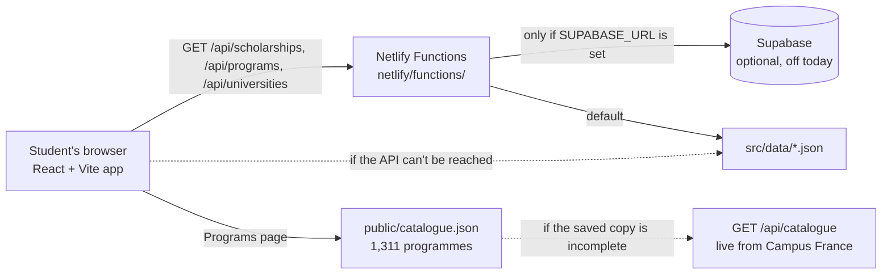
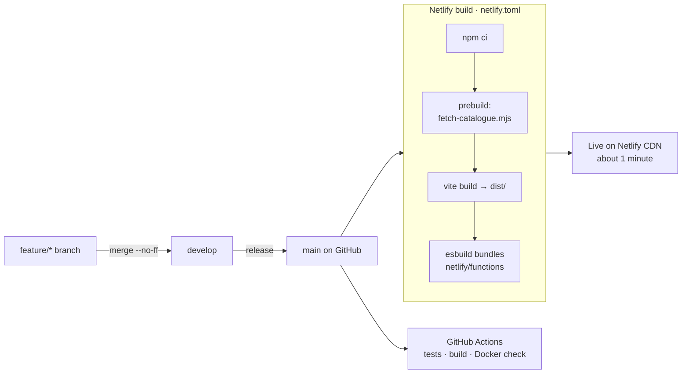

# SpotScholars

**A Voice from North, for All.** One free place for international students coming to France: scholarships, English-taught programmes, universities, and step-by-step guides for admissions, visa, costs, housing and arrival.

**Live:** https://spotscholars.netlify.app · **Repository:** https://github.com/mehdee-waseem/spotscholars

> Final project for *Building Digital Products with Generative AI* (EUNICE, 2026). Built with Claude Code, from idea to a deployed product.

---

## 1. What it is

**The problem.** Students from Pakistan and South Asia who want to study in France find the information scattered across dozens of sites, many of them in French: the Campus France procedure, scholarships on separate portals, a catalogue of ~1,300 English-taught programmes that is hard to search, and visa, housing and cost rules spread over several official pages. The SpotScholars community (WhatsApp, YouTube, Instagram) gets the same questions again and again.

**Who it's for.**
- **Students** planning a Bachelor, Master or PhD in France, mainly from Pakistan and South Asia, often reading on a phone in their second language.
- **SpotScholars volunteers** who answer those students and need one reliable link to send.

**Minimum moment of value.** In under a minute, a student finds an English-taught programme in their field and a scholarship they can apply for, with the official link to act on.

**In one sentence:** SpotScholars turns the scattered, French-language information about studying in France into one searchable site that always links to the official source.

## 2. Features

### User stories in the MVP

| ID | User story | Where |
| --- | --- | --- |
| US-01 | As a **student from Pakistan**, I want to search and filter scholarships by level and type, so that I see only the ones I can apply for, with their deadline and amount. | `/scholarships` |
| US-02 | As a **student**, I want to search every English-taught programme in France by field, level, region, public/private and national fees, so that I can build a realistic shortlist. | `/programs` |
| US-03 | As a **first-time applicant**, I want step-by-step guides for the Campus France Pakistan procedure, visa, costs, housing and arrival, so that I don't miss a step or a deadline. | `/guide/*` |
| US-04 | As a **SpotScholars volunteer**, I want every filtered list to have its own URL, so that I can answer a WhatsApp question with one link. | all lists |

### What's in the MVP

| Page | URL | What it does |
| --- | --- | --- |
| Home | `/` | Search, the "two roads" admissions explainer, journey steps, featured scholarships, deadline countdown banner, FAQ |
| Scholarships | `/scholarships` | 27 scholarships, searchable, filter by type and level |
| Programs | `/programs` | Full Campus France catalogue (~1,300 programmes, refreshed at every deploy) + 149 hand-picked programmes with tips |
| Universities | `/universities` | 83 curated institutions + searchable list of all 369 Campus France Forum institutions |
| Guides | `/guide/pakistan`, `/guide/admissions`, `/guide/costs`, `/guide/visa`, `/guide/housing`, `/guide/arrival` | Six step-by-step guides |
| Resources | `/resources` | 100+ official links in 11 groups, YouTube session and video guides |
| Contact | `/contact` | Contact form (Netlify Forms) and community links |

### Backlog (not in the MVP)

- **AI study assistant**: answers questions in English or Urdu using only the site's content, and cites the official link.
- Deadline reminders by email or WhatsApp.
- Urdu version of the guides.
- Volunteer admin through Supabase (the schema and the API support are already in the repo, not switched on).
- Saved shortlists for students.
- Automatic broken-link checker; move the last five `http://` programme links to `https://`.

## 3. How to run it, and how it works

### Run it locally

**Requirements:** Node.js 20+ and npm. Docker is optional.

```bash
git clone https://github.com/mehdee-waseem/spotscholars.git
cd spotscholars
npm install
npm run dev            # http://localhost:5173
```

That's all you need: with no database, the site uses the JSON files in `src/data/`.

| Task | Command |
| --- | --- |
| Run the tests (77 tests) | `npm test` |
| Tests in watch mode | `npm run test:watch` |
| Production build | `npm run build` (downloads the Campus France catalogue first) |
| Build without the download | `npx vite build` |
| Site + API functions locally | `npm i -g netlify-cli` then `npm run dev:netlify` (http://localhost:8888) |

**Environment variables.** None are required. To read data from Supabase instead of the JSON files, copy `.env.example` to `.env` and fill in `SUPABASE_URL` and `SUPABASE_SERVICE_KEY` ([docs/SUPABASE.md](docs/SUPABASE.md)). `.env` is git-ignored.

**Docker.**

```bash
docker compose up web   # production build served by nginx → http://localhost:8080
docker compose up dev   # Vite dev server with live reload → http://localhost:5173
```

The Docker image serves the built site. The `/api/*` functions only run on Netlify; inside Docker the pages load the same data from the bundled JSON automatically.

**DevContainer.** Open the folder in VS Code → *Reopen in Container*. You get Node 20, the dependencies installed, and the Claude Code, Tailwind and Vitest extensions.

### How data flows



1. A page asks the API for its data, for example `/api/scholarships?level=PhD`. `netlify.toml` sends every `/api/*` request to the function of the same name.
2. The function reads Supabase **only if** `SUPABASE_URL` and `SUPABASE_SERVICE_KEY` are set. Today they aren't, so it reads the JSON files in `src/data/`. If Supabase fails, it falls back to the JSON too. Responses are cached for 5 minutes.
3. If the API can't be reached at all (plain `npm run dev`, the Docker image, an outage), `src/lib/api.js` loads the same JSON that is bundled with the page. **The site works with no database and no API.**
4. The **Programs** page reads `public/catalogue.json`, the Campus France catalogue saved at build time. If that copy is incomplete, it asks `/api/catalogue`, which fetches the live list from Campus France.
5. Search text and filters live in the URL (`src/lib/useFilters.js`), so a filtered list such as `/programs?field=Cybersecurity` can be shared as a link.

### How it deploys



1. Work happens on a `feature/<name>` branch, is merged into `develop`, then `develop` is merged into `main` for a release.
2. **Every push to `main` deploys automatically.** Netlify reads `netlify.toml`: Node 20, build command `npm run build`, publish folder `dist`, functions folder `netlify/functions`.
3. `npm run build` first runs `prebuild` → `scripts/fetch-catalogue.mjs`, which downloads the Campus France "Taught in English" catalogue (about 1,300 programmes plus each one's website, fees and length) into `public/catalogue.json`. If Campus France is down, it keeps the old file and the build carries on.
4. Vite builds the React app into `dist/`; Netlify bundles each function with esbuild.
5. `netlify.toml` routing: `/api/*` → the functions, every other path → `index.html` (so React Router handles `/programs`, `/guide/visa`…), and files in `/assets/` are cached for a year.
6. In parallel, GitHub Actions (`.github/workflows/ci.yml`) runs the 77 tests, a production build, and builds and starts the Docker image.
7. To refresh the catalogue without changing code: Netlify → Deploys → **Trigger deploy**. First-time setup, the contact-form emails and a custom domain are in [docs/DEPLOY.md](docs/DEPLOY.md).

### API

On the live site:

| Endpoint | Example |
| --- | --- |
| `GET /api/health` | https://spotscholars.netlify.app/api/health |
| `GET /api/scholarships?q=&level=&type=` | `/api/scholarships?level=PhD&type=Government` |
| `GET /api/programs?q=&level=&field=` | `/api/programs?field=Cybersecurity` |
| `GET /api/universities?q=&type=&region=` | `/api/universities?q=paris` |
| `GET /api/catalogue` | live fallback for the Campus France catalogue |

### Project structure

```
spotscholars/
├── src/
│   ├── main.jsx                   # entry point: React + BrowserRouter
│   ├── App.jsx                    # routes, page titles, lazy-loaded pages
│   ├── index.css                  # Tailwind layers and a few custom styles
│   ├── pages/
│   │   ├── Home.jsx               # search, "two roads" explainer, journey, featured scholarships, deadline banner, FAQ
│   │   ├── Scholarships.jsx       # search + type and level filters
│   │   ├── Programs.jsx           # two tabs: full Campus France catalogue | SpotScholars picks
│   │   ├── Universities.jsx       # curated list + the 369-institution directory
│   │   ├── Guide.jsx              # /guide/:slug, renders src/data/guides.js
│   │   ├── Resources.jsx          # 100+ official links, video guides, YouTube channels
│   │   ├── Contact.jsx            # contact form (Netlify Forms) and social links
│   │   └── NotFound.jsx
│   ├── components/
│   │   ├── Catalogue.jsx          # loads catalogue.json, field tiles, filters, pagination
│   │   ├── ForumDirectory.jsx     # searchable Campus France Forum list
│   │   ├── Navbar.jsx · Footer.jsx · PageHeader.jsx · FilterBar.jsx
│   │   └── CommunityCTA.jsx · Video.jsx · Icons.jsx · Loader.jsx · EmptyState.jsx
│   ├── data/                      # ← THE CONTENT: edit these to update the site
│   │   ├── scholarships.json      # 27 scholarships
│   │   ├── programs.json          # 149 hand-picked programmes with tips
│   │   ├── universities.json      # 83 institutions
│   │   ├── forum-members.json     # 369 Campus France Forum institutions
│   │   ├── private-institutions.json  # private/consular schools in the catalogue
│   │   ├── guides.js              # the six guides
│   │   ├── resources.js           # link groups, featured video, video guides, channels
│   │   └── resources-extra.json   # extra link groups
│   └── lib/
│       ├── api.js                 # fetch /api/*, fall back to the bundled JSON
│       ├── useFilters.js          # search text and filters kept in the URL
│       ├── catalogueMeta.js       # labels for catalogue fields, levels and regions
│       └── links.js               # social links, menu, guide menu, deadline alerts
├── netlify/functions/             # serverless API → /api/*
│   ├── _shared.js                 # Supabase-or-JSON loader, JSON response, search helper
│   ├── scholarships.js            # GET /api/scholarships?q=&level=&type=
│   ├── programs.js                # GET /api/programs?q=&level=&field=
│   ├── universities.js            # GET /api/universities?q=&type=&region=
│   ├── catalogue.js               # GET /api/catalogue (live Campus France fallback)
│   └── health.js                  # GET /api/health
├── scripts/
│   ├── fetch-catalogue.mjs        # runs before every build → public/catalogue.json
│   └── seed-supabase.mjs          # copies the JSON data into Supabase (optional)
├── public/                        # logos, favicons, og-image, web manifest, catalogue.json
├── tests/                         # Vitest, 77 tests: api, data, catalogue, pages
├── supabase/schema.sql            # optional database tables
├── docs/                          # CONTENT.md, DEPLOY.md, SUPABASE.md
├── .devcontainer/devcontainer.json  # development environment
├── Dockerfile · docker-compose.yml · docker/nginx.conf
├── .github/workflows/ci.yml       # tests, build and Docker check on every push
├── CLAUDE.md · AGENTS.md          # project context and rules for AI agents
├── netlify.toml                   # build, functions, redirects, cache headers
├── vite.config.js · tailwind.config.js · postcss.config.js
└── .env.example                   # optional Supabase variables (the real .env is never committed)
```

### Updating content, links and the menu

| To change… | Edit | Notes |
| --- | --- | --- |
| Scholarships, programmes, universities | `src/data/*.json` | Fields and examples in [docs/CONTENT.md](docs/CONTENT.md). Editing on github.com is fine. |
| A guide, or add a new one | `src/data/guides.js` (+ `GUIDE_NAV` in `src/lib/links.js`) | A new guide becomes `/guide/<slug>`. |
| Links, videos | `src/data/resources.js` | `FEATURED_VIDEO` is the big video on the home and Resources pages. |
| Social links and the menu | `src/lib/links.js` (`LINKS`, `NAV`) | WhatsApp, YouTube, Instagram, Linktree, email. |
| The deadline banner | `ALERTS` in `src/lib/links.js` | Shows a countdown and disappears after its `until` date. |
| Colours and fonts | `tailwind.config.js` | Navy `#1f299c`, orange `#ff851b`; Sora and Plus Jakarta Sans. |

Run `npm test` before you commit: the data tests catch broken links between programmes and universities, wrong filter values and duplicate ids. After a push to `main`, the site updates in about a minute.

## 4. How it was built with AI

**Agent:** Claude Code (Claude Opus 5.5). The first version was built in one session of Claude Code on the web; the course deliverables (CLAUDE.md, DevContainer, Docker, tests, CI, this README) were added with Claude Code desktop. Every commit carries `Co-Authored-By: Claude` and the first ones link to the original session.

### The cycle

```
 idea + content (me) ──► plan + code (Claude) ──► check in the browser (me) ──► commit + push ──► Netlify deploy
        ▲                                                                                          │
        └────────────────────────────── next feature, next content batch ◄───────────────────────────┘
```

| Date | Step | Commits |
| --- | --- | --- |
| 5 Nov 2026, 17:18 → 18:47 | Idea to deployed site in **about 90 minutes**: React + Netlify Functions skeleton, Pakistan guide and resources, bookmark collection imported, full Campus France catalogue, catalogue filters, favicon | 6 |
| 12 Nov 2026 | Course workflow added on `feature/course-deliverables` → `develop`: CLAUDE.md/AGENTS.md, DevContainer, Docker, 77 tests, CI, README in five sections | 6 (Conventional Commits) |

### What the AI did and what I did

| Part | Me | Claude Code |
| --- | --- | --- |
| Idea and scope | The problem, from running the SpotScholars community; who it is for; what goes in the MVP | Turned it into pages and a data model |
| Content | Chose the sources: my bookmark folders, official Campus France pages, community knowledge; decided what to leave out | Structured it into JSON (scholarships, programmes, universities), drafted the guide text from the official pages |
| Design | Brand colours from the logo, the "two roads" explanation of admissions | Layout and Tailwind components, mobile-first pages, the favicon redrawn for 16 px |
| Code | Reviewed every change in the browser | All the code: React pages, Netlify Functions, the Campus France catalogue sync script, the JSON fallback |
| Quality | Checked facts (fees, dates) against official sources | Wrote the 77 tests and the CI pipeline |
| Deploy | Connected GitHub to Netlify | `netlify.toml`, redirects, cache headers |

### A real prompt

The prompt that started the course deliverables (12 Nov), excerpts exactly as typed:

> *"So are the final task to submit somthing wee create using AI , so we want to make a presattion or anythings to describe our project in final thesis … i recntly make one website for my scholarship group containing all information regarding study in france … analyze all details carefully and  and go for some solutions"*

From that, the agent read the course slides, compared the repository with the required deliverable (README, CLAUDE.md, DevContainer, Docker, tests), listed what was missing, and built it on a feature branch. Project rules for the agent are in [CLAUDE.md](CLAUDE.md).

### What went well

- **Speed.** A real, useful site with seven sections was live in about 90 minutes.
- **No database needed.** The data is plain JSON that a volunteer can edit on github.com; Supabase is ready but optional, and the API falls back to the JSON if it fails.
- **Live data.** The agent found the Campus France catalogue API and wrote a script that refreshes ~1,300 programmes at every deploy, keeping the old copy if Campus France is down.
- **Shareable filters.** Keeping filters in the URL made the site directly useful for answering WhatsApp questions.

### What was hard (honestly)

- **Facts change every year.** The AI can draft fees, deadlines and procedures, but they had to be checked against the official pages. The site shows a disclaimer, links every item to its source, and `docs/CONTENT.md` has a yearly checklist.
- **I built first and followed the process later.** The first version went straight to `main`, without tests, a `develop` branch, CLAUDE.md or Conventional Commits. All of that was added afterwards. Next time I would set up the workflow first.
- **Tests corrected my assumptions.** The first test run failed twice: once because the repository ships a 55-programme sample catalogue on purpose (the full list is downloaded at build time), so the test was wrong; and once because five programme links still use `http://`, which is now in the backlog.
- **Docker vs Netlify.** Netlify Functions don't run in a plain Docker container, so the Docker image serves the static site and relies on the JSON fallback.

## 5. Status and next steps

**Status: MVP live in production** at https://spotscholars.netlify.app since 5 November 2026.

| | |
| --- | --- |
| Works | All 7 sections; search and filters; 27 scholarships, 149 hand-picked + ~1,300 catalogue programmes, 83 + 369 institutions, 6 guides, 100+ links; contact form; deadline banner; `/api/health` OK |
| Tests | 77 passing (`npm test`), run in CI on every push |
| Not yet | Supabase isn't switched on (data comes from JSON); there are no analytics, so I don't know how many students use it yet; the guides are English-only |

**Next steps, in order:**
1. **AI study assistant**: a chat on the site that answers questions from SpotScholars' own content, in English or Urdu, and always cites the official link. This is the natural next step for a product built with generative AI.
2. Privacy-friendly analytics, to see which pages students actually use.
3. Deadline reminders, so students don't miss Campus France and scholarship dates.
4. Urdu guides.
5. Switch on Supabase so volunteers can update content from a dashboard.

---

**Disclaimer:** the information is a guide only. Fees, deadlines and rules change; every item links to the official source.

**Brand:** navy `#1f299c`, orange `#ff851b` (from the logo); fonts Sora and Plus Jakarta Sans.
